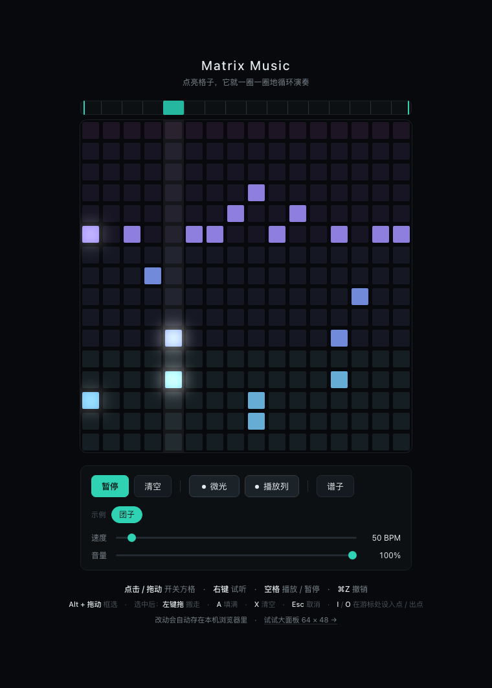
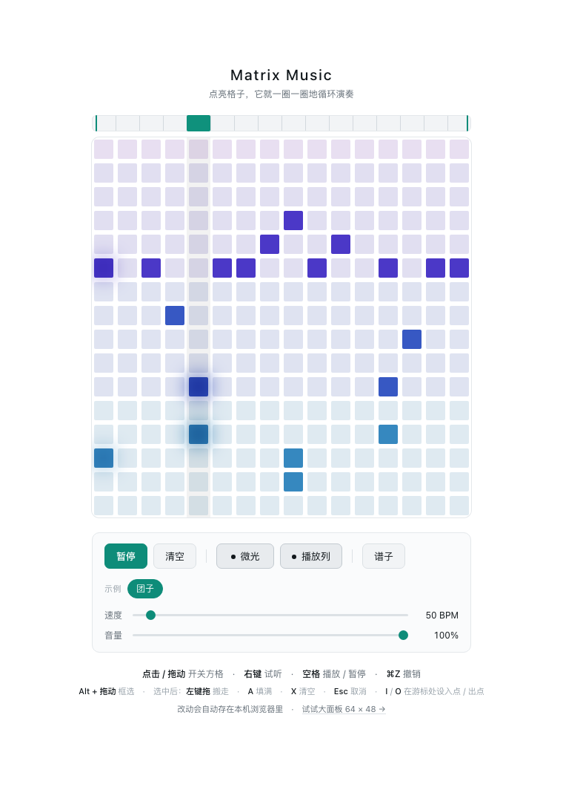
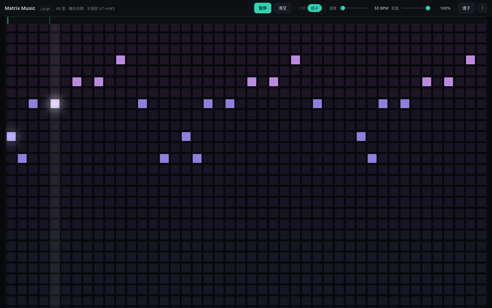
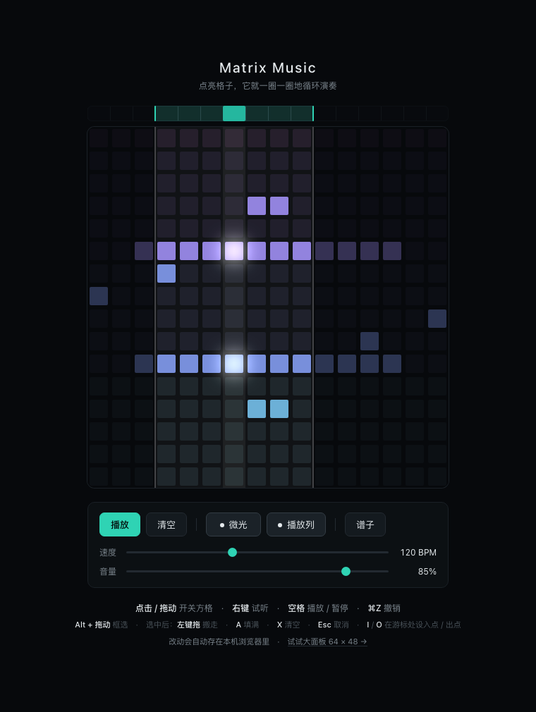

# Matrix Music

**Matrix Music** 是一个放在浏览器里的音乐盒：点亮格子，它就会一圈一圈地循环演奏。

不用安装任何东西，打开网页就能玩。每八度一个颜色，深色 / 浅色跟随系统自动切换。

<p align="center">
  
  
</p>

<p align="center"><sub>左：深色主题　右：浅色主题 —— 跟随系统外观自动切换</sub></p>

## 两个面板

两版用同一套引擎，只是网格规格不同：

| | 基准版（`index.html`） | 大面板（`large.html`） |
|---|---|---|
| 网格 | 16 步 × 16 音 | **横向无限**（1024 步）× 48 音 |
| 音阶 | D 大调五声 | 半音阶 —— 相邻行差一个半音，像吉他每格一品 |
| 音域 | A6 → A3（3 个八度） | A7 → A#3（47 个半音，将近 4 个八度） |
| 一圈 | 2 秒 @120BPM | 默认 64 步，出点可以一直往右拖 |
| 方块 | 26px | 26px —— 跟基准版一样大 |

<p align="center">
  
</p>

<p align="center"><sub>大面板：48 行跨近 4 个八度，分成 5 条色带；横向可以一直往右画</sub></p>

**横向没有尽头**：一块画布只渲染你眼前那一段，往右拖就一直画下去，没有「到边了」这件事。
平移方式：触控板横滑 / **Shift + 滚轮** / **中键拖动**，画到画布边缘会自动继续，
播放时视口会跟着播放头走。纵向仍然在框内滚动（48 行 × 32px = 1536px，装不进屏幕），
页头和控件不会跟着滚走。

因为只画可见的那一段，**大面板在笔记本上也不用先把窗口拖来拖去**了 ——
打开就是整屏宽度，方块仍然是 26px，和基准版一样大。

界面是一条**顶栏**：标题、简介、播放 / 清空、示例、速度、音量、谱子、快捷键全在一行里，
棋盘吃掉顶栏以下的全部高度。谱子和快捷键都是**浮层**，弹出来不会把棋盘挤下去。

**单步时长两版完全一样**，所以大面板变长的是段落，不是音符的快慢。
大面板的音阶是基准版五声的**超集**：基准版每个音都能在新面板里找到，
只是行号变了，所以要照搬图案得重新数格子。

## 怎么玩

| 你做的操作 | 会发生什么 |
|---|---|
| 左键**点一下空格子** | 落一个音，同时响一声 —— 画的时候就能听见画的是什么 |
| 左键**再点一下那个音** | 关掉它，**不出声** |
| **按住左键拖动** | 连续画一整条线；**从有音的地方起手**就变成连续擦除 |
| **按住右键拖动** | 拉出一个框，选中一片格子（右键单击则只选一格） |
| 空格 | 播放 / 暂停 |
| **拖标尺上的两个把手** | **设回环的入点 / 出点** —— 或者把游标停到某列，按 **I** / **O** |
| **拖棋盘上方那条标尺** | **把播放游标挪到任意一列**（点一下跳过去，按住拖就是擦洗） |
| **⌘Z**（Windows 上 Ctrl+Z） | 撤销。一次操作算一步，不会退成十几步 |
| **⌘⇧Z**（或 Ctrl+Y） | 反撤销 |
| **在选中的框里按住左键拖** | 整块搬走；只是点一下则开关那一格 |
| **按住 Alt 再拖选中的框** | **复制一份**拖到别处，原件留在原地（Figma / Illustrator 的 Option+拖动） |
| **A** / **X** | 把选中的这一块填满 / 清空（**X 也是删掉一个音的常规入口**） |
| **⌘C** / **⌘X** / **⌘V** | 复制 / 剪切 / 粘贴选中的那一块 |
| **Esc** | 取消选中 |
| 「清空」按钮 | 全部擦掉（这一步也能撤销回来） |
| 「谱子」按钮 | 展开保存面板，代码会跟着谱子实时更新，也可以粘贴别人的代码载入 |

打开页面就是可以玩的，没有「先点一下启用声音」的遮罩。
浏览器规定声音必须在用户操作之后才能响，所以是**你的第一次点击顺手完成解锁** ——
想听就按空格或点「播放」。

## 示例谱：先听，再画（只在大面板）

**大面板**的控件区有一个示例：团子 —— 《团子大家族》全曲，在大面板上分段排好、
按拍号拼成一条（**785 个音、897 列、4 分半**）。点一下就载入并开始播放，回环已经设成整条。

**16 列面板没有这个示例**，这是刻意的：897 列的歌塞进 16 列只剩 9 个音，
那不是「短一点」，是听不出曲子。与其给一个残缺的片段，不如不给 ——
基准版就是一张干净的画布，你自己画什么就是什么。

想直接打开就是这首，用 URL 参数：

```
large.html?demo=dango
```

这条路和 chip 等价，但**都不会自动播放** —— 浏览器也不允许，得你自己按一下播放。
反过来，什么都不带打开时，棋盘是空的，按播放就是安静的循环：应用不会背着你装谱。

- 载入示例前会存一步撤销，⌘Z 随时能退回自己画的东西
- 一动笔，chip 上的选中态就褪掉 —— 那已经是你自己的谱子了

## 回环：一张图能走成很多首歌

棋盘上方那条标尺就是**回环**。上面有两个把手 —— **入点**和**出点**，
中间那段是高亮的，只有它会被播放。

- **拖把手**直接改区间
- 或者把游标停到某一列，按 **I** 设入点、按 **O** 设出点（跟 DAW 的习惯一致）
- 默认整圈：入点在 0、出点在最后一列

区间比整圈短时，播放头走过出点就回到入点 —— 于是图案每转一圈就和自己的
前半段错开几格，两部分相位一路滑移：

| 画布 | 回环 | 走多少步才回到原点 |
|---|---|---|
| 16 列 | 13 步 | 208 步 |
| 64 列 | 43 步 | 2752 步 |

你只画了一张静态图案，听到的却是一条一直在变化的旋律。区间外的列会压暗、
两条边界各画一条竖线，所以「哪几列不会播」始终看得见，不会变成谜。

这一项也是这个作品和普通「格子音序器」最不一样的地方：别人让你画一段循环，
这里让你画一段**会自己走远**的循环。

<p align="center">
  
</p>

<p align="center"><sub>入点 3、出点 9：中间七列高亮播放，两侧压暗但不删除</sub></p>

## 保存与分享

**你不用手动保存** —— 每改一下就自动存在浏览器本地，刷新或关掉重开都还在。
两个面板各存各的，互不覆盖。

想把工程发给别人、或者换台机器接着弹，点「谱子」：

- **复制** 得到一段代码（比如 `MM3.AbCd...`），发给对方
- 对方点「谱子」，把代码粘进输入框，点 **载入** —— 听到的和你做的完全一样

代码里装的是**整份工程状态**，不只是音符：点亮的音符、回环的入点/出点、
速度、音量全在里面。所以对方打开时不会「音符对了但快慢不对」。

代码存的是**音高**而不是「第几行」，所以**换个面板也照样能载** —— 以后大面板再加
音域、或者换个音阶，旧代码都还对得上。跨面板载入时，本面板没有的音高会自动
就近对齐到最接近的音，超出宽度的时间步会被丢掉，界面上会如实告诉你各有多少个。

格式是 `JSON → LZW → base64url`，这段代码比只记音符的旧格式长约 3~5 倍
（16×16 三个音符约 94 个字符），换来的是「参数跟着走」，而且解开压缩就能直接读。

下方还有几样可以调的：

- **速度** —— 循环有多快（40 ~ 240 BPM）
- **音量** —— 声音大小
- **微光** —— 播放到某一列时，那一列的格子像灯泡一样亮一下再暗下去，不喜欢可以关掉
- **播放列** —— 一条淡淡的竖线，标记现在循环到哪一列

## 它是怎么发声的

16 列就是一小节里的 16 步，从左到右循环播放；从上到下则是从 A6 到 A3 的一串
D 大调五声音阶。因为只用五个音，所以**随手乱点也不会难听** —— 把几个格子摆成
某种形状，往往就是一个好听的琶音。

大面板干脆换成了**半音阶**：48 行从 A7 一路排到 A#3，相邻行只差一个半音，
跟吉他每格一品一样。这样什么调都能弹，但也意味着**随手乱点会很难听** ——
五声音阶那个「怎么点都好听」的魔法没有了，得自己动耳朵挑音。

音色是纯正弦波：每个音一次相位累加发声，套一条平方衰减的包络
（`amp(t) = (0.4·(1−t/T))²`），**不加任何延迟或混响** —— 干声直出，
你画什么就听到什么，音符之间不会有从别处拍回来的重影。
时序全部由 Web Audio 的音频时钟驱动，改速度、暂停、拖动游标都不会让音画错位。

## 配色

**每八度一个颜色**，不是一个连续渐变：同一个八度里的格子同色，换八度就换一档
（青 → 蓝 → 紫，越高越亮）。于是图案读起来是几条色带 —— 哪一段在高音区、
哪一段沉在低音区，一眼就分得开。

为什么不用连续渐变：48 行面板上相邻行只差半个音，颜色几乎一样，等于没编码；
八度是音乐里真实的分层单位，按它切块才有意义，块数也不多（16 行 4 块、48 行 5 块）。

颜色按 **MIDI 八度号**取，不是按行号 —— 所以同一个音高在 16 行和 48 行面板里
永远是同一个颜色。未点亮的格子用同色相的极淡版本，网格因此也是分色带的，
而不是一张灰色方格纸。

除格子之外的东西（播放列、试听描边、框选、微光）一律保持中性，
保证「有颜色的东西 = 有音的东西」这条视觉语法不被破坏。

两套明暗配色默认跟随系统的「外观」设置，切换时即时生效、不用刷新：

| | 深色 | 浅色 |
|---|---|---|
| 底色 | 近黑的冷调 `#07090C` | 纯白 |
| 主色（按钮 / 游标 / 滑块） | 青绿 `#2FD3B4` | 深青绿 `#0E8C79` |
| 八度色带 | 青 → 蓝 → 紫，越高越亮 | 同上，明度压到白底能读 |
| 微光 | 加法提亮（`lighter`） | 加浓（`multiply` + 同色相浅色）：格子变深，周围散出同色光 |

想固定看某一套，在地址后面加 `?theme=light` 或 `?theme=dark`
（截图和回归测试就是这么钉住的）。

## 关于

- 原生 JavaScript + Canvas 2D + Web Audio，**无框架、无构建、无依赖**
- 整个项目就是一个网页：双击 `index.html` 就能跑，不需要起服务
- 内置 117 项自动化回归（`test/selftest.html`），覆盖音高换算、时序、渲染、
  存储与交互边界；页面级交互另有 `test/interaction.html` 与 `test/large.html`

## 本地运行

把仓库下载下来，双击 `dist/index.html`（或 `dist/large.html`）就能玩，仅此而已。
站点全部在 `dist/` 里：两个 HTML、一个 CSS、`dist/js/*.js` —— 没有构建步骤。

跑回归：

```bash
bash scripts/ci-test.sh          # 自动找 Chrome
```
